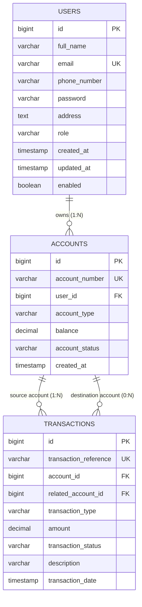

# Smart Banking Management System - Database Documentation

## 1. Overview
The **Smart Banking Management System** database is engineered to handle relational financial data with strict ACID guarantees, high-precision monetary math (`DECIMAL(15, 2)`), optimistic and pessimistic concurrency control, and relational integrity.

> **Notice**: This system is strictly an educational simulation. All financial transactions operate on simulated ledger entries. No connections to live banking clearing networks (ACH, SWIFT, SEPA) are made.

---

## 2. Entity-Relationship (ER) Diagram



---

## 3. Schema Definitions and Tables

### 3.1. `users` Table
Stores authenticated credentials and profile details for both customers and bank administrators.

| Column | Data Type | Constraints | Description |
| :--- | :--- | :--- | :--- |
| `id` | `BIGINT` | `PRIMARY KEY AUTO_INCREMENT` | Unique identifier for each user |
| `full_name` | `VARCHAR(100)` | `NOT NULL` | Customer or administrator legal full name |
| `email` | `VARCHAR(100)` | `NOT NULL UNIQUE` | Unique email used as login username |
| `phone_number`| `VARCHAR(20)` | `NOT NULL` | Contact telephone number |
| `password` | `VARCHAR(255)` | `NOT NULL` | One-way BCrypt password hash (strength 10) |
| `address` | `TEXT` | `NOT NULL` | Registered residential or physical address |
| `role` | `VARCHAR(20)` | `NOT NULL`, `CHECK (role IN ('ROLE_CUSTOMER', 'ROLE_ADMIN'))` | Role-based authorization tag |
| `created_at` | `TIMESTAMP` | `DEFAULT CURRENT_TIMESTAMP` | Account creation timestamp |
| `updated_at` | `TIMESTAMP` | `DEFAULT CURRENT_TIMESTAMP ON UPDATE` | Last modification timestamp |
| `enabled` | `BOOLEAN` | `NOT NULL DEFAULT TRUE` | Status toggle for deactivation / suspension |

**Indexes:**
- `idx_users_email` ON `users(email)`: Speeds up authentication lookups during login.
- `idx_users_role` ON `users(role)`: Facilitates administrative customer filtering.

---

### 3.2. `accounts` Table
Maintains bank accounts, ledger balances, and operational lifecycle statuses.

| Column | Data Type | Constraints | Description |
| :--- | :--- | :--- | :--- |
| `id` | `BIGINT` | `PRIMARY KEY AUTO_INCREMENT` | Unique account identifier |
| `account_number` | `VARCHAR(20)` | `NOT NULL UNIQUE` | Formatted account number (`SB-XXXXXXXXXX` / `CA-XXXXXXXXXX`) |
| `user_id` | `BIGINT` | `NOT NULL`, `FOREIGN KEY REFERENCES users(id) ON DELETE RESTRICT` | Account owner |
| `account_type` | `VARCHAR(20)` | `NOT NULL`, `CHECK (account_type IN ('SAVINGS', 'CURRENT'))` | Type of banking account |
| `balance` | `DECIMAL(15, 2)` | `NOT NULL DEFAULT 0.00`, `CHECK (balance >= 0.00)` | Available ledger balance |
| `account_status` | `VARCHAR(20)` | `NOT NULL DEFAULT 'ACTIVE'`, `CHECK (account_status IN ('ACTIVE', 'INACTIVE', 'FROZEN'))` | Lifecycle operational status |
| `created_at` | `TIMESTAMP` | `DEFAULT CURRENT_TIMESTAMP` | Timestamp of account opening |

**Constraints:**
- `chk_account_balance`: Disallows negative account balances directly at the database engine level.
- `ON DELETE RESTRICT`: Prevents accidental deletion of users having existing account histories.

**Indexes:**
- `idx_accounts_account_number` ON `accounts(account_number)`: Instant lookups by customer-visible account numbers.
- `idx_accounts_user_id` ON `accounts(user_id)`: Quick aggregation of a customer's accounts.
- `idx_accounts_status` ON `accounts(account_status)`: Efficient administrative status filtering.

---

### 3.3. `transactions` Table
Maintains an immutable financial audit trail of all deposits, withdrawals, and account-to-account transfers.

| Column | Data Type | Constraints | Description |
| :--- | :--- | :--- | :--- |
| `id` | `BIGINT` | `PRIMARY KEY AUTO_INCREMENT` | Unique transaction ID |
| `transaction_reference` | `VARCHAR(36)` | `NOT NULL UNIQUE` | Unique reference code (`TXN-YYYYMMDD-XXXXX`) |
| `account_id` | `BIGINT` | `NOT NULL`, `FOREIGN KEY REFERENCES accounts(id) ON DELETE RESTRICT` | Source or primary account |
| `related_account_id` | `BIGINT` | `NULL`, `FOREIGN KEY REFERENCES accounts(id) ON DELETE RESTRICT` | Counterparty account for fund transfers |
| `transaction_type` | `VARCHAR(20)` | `NOT NULL`, `CHECK (transaction_type IN ('DEPOSIT', 'WITHDRAWAL', 'TRANSFER_IN', 'TRANSFER_OUT'))` | Nature of transaction |
| `amount` | `DECIMAL(15, 2)` | `NOT NULL`, `CHECK (amount > 0.00)` | Transaction monetary amount |
| `transaction_status` | `VARCHAR(20)` | `NOT NULL DEFAULT 'SUCCESS'`, `CHECK (transaction_status IN ('SUCCESS', 'FAILED'))` | Transaction execution state |
| `description` | `VARCHAR(255)` | `NULL` | Transaction remarks or memo |
| `transaction_date` | `TIMESTAMP` | `DEFAULT CURRENT_TIMESTAMP` | Execution timestamp |

**Indexes:**
- `idx_transactions_reference` ON `transactions(transaction_reference)`: Fast transaction lookup by reference number.
- `idx_transactions_account_id` ON `transactions(account_id)`: Speeds up customer statement rendering.
- `idx_transactions_date` ON `transactions(transaction_date)`: Facilitates date-range queries for admin reporting.
- `idx_transactions_type` ON `transactions(transaction_type)`: Accelerates volume aggregations.

---

## 4. Concurrency Control and Locking Strategy

### 4.1. The Concurrency Challenge
In multi-user banking applications, concurrent operations introduce two primary hazards:
1. **Race Conditions / Lost Updates**: Two withdrawals executing concurrently on the same balance could read identical starting values and both succeed, driving the account balance below zero.
2. **Deadlocks in Transfers**: If Customer A transfers money to Customer B while Customer B transfers money to Customer A simultaneously, naive locking (`lock(A) then lock(B)` vs `lock(B) then lock(A)`) produces a cyclical lock dependency deadlock.

### 4.2. Pessimistic Write Locking (`PESSIMISTIC_WRITE`)
In `AccountRepository.java`:
```java
@Lock(LockModeType.PESSIMISTIC_WRITE)
@Query("SELECT a FROM Account a WHERE a.accountNumber = :accountNumber")
Optional<Account> findByAccountNumberWithLock(@Param("accountNumber") String accountNumber);
```
- Emits SQL `SELECT ... FOR UPDATE` in MySQL.
- Holds an exclusive row-level lock on the selected account record until the enclosing `@Transactional` method commits or rolls back.

### 4.3. Deterministic Alphabetical Lock Ordering (Deadlock Prevention)
To eliminate deadlocks during bidirectional transfers:
```java
String firstLock = fromAccNumber.compareTo(toAccNumber) < 0 ? fromAccNumber : toAccNumber;
String secondLock = fromAccNumber.compareTo(toAccNumber) < 0 ? toAccNumber : fromAccNumber;

Account firstAccount = accountRepository.findByAccountNumberWithLock(firstLock)
        .orElseThrow(...);
Account secondAccount = accountRepository.findByAccountNumberWithLock(secondLock)
        .orElseThrow(...);
```
**Proof of Deadlock Freedom**:
Since every thread consistently acquires locks in alphabetical order by `account_number`, a cyclical dependency (`Thread 1: A -> B` and `Thread 2: B -> A`) is mathematically impossible. One thread always acquires the lower-ordered account first, while the other waits gracefully.

---

## 5. Transaction Boundary & Data Integrity
- All state-modifying service operations are marked `@Transactional(rollbackFor = Exception.class)`.
- If an exception occurs (e.g., `InsufficientBalanceException`, `AccountInactiveException`, or database timeout), Hibernate rolls back all uncommitted balance adjustments and ledger rows atomically.
- All monetary math utilizes `BigDecimal` with rounding mode `RoundingMode.HALF_UP` and a strict scale of 2 decimal places, avoiding floating-point inaccuracies.
