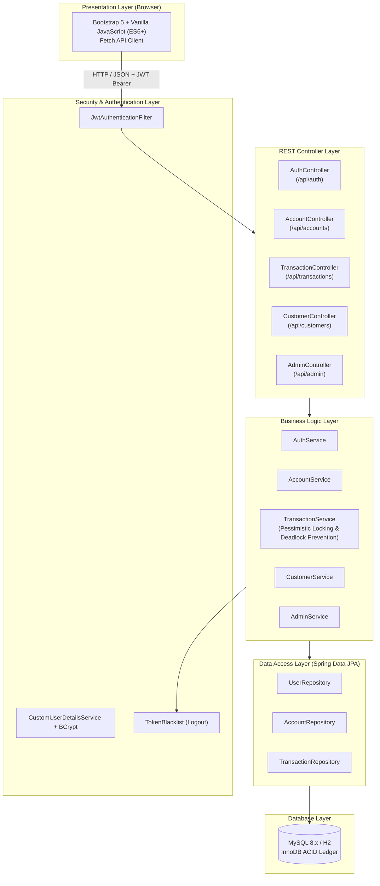

# Smart Banking Management System

[](https://www.oracle.com/java/)
[](https://spring.io/projects/spring-boot)
[](https://spring.io/projects/spring-security)
[](#testing)
[](LICENSE)

An enterprise-grade, full-stack **Smart Banking Management System** built with Spring Boot 3.x, Spring Data JPA, Hibernate, Spring Security 6 with stateless JWT authentication, and a responsive Bootstrap 5 frontend.

> **DISCLAIMER: EDUCATIONAL SIMULATION ONLY**  
> This system is strictly an educational banking simulation. All transactions, accounts, and financial balances utilize simulated funds recorded in a local relational database ledger. The application **does not** connect to real banks, payment gateways, card networks (Visa/Mastercard), or interbank clearing systems (SWIFT/ACH/UPI).

---

## 1. System Architecture



---

## 2. Key Features

### Customer Banking Portal
- **Secure Registration & Login**: Real-time password confirmation, input validation, and BCrypt password encryption.
- **Dynamic Dashboard**: Summary cards for total balance, active accounts count, recent transactions, and quick action shortcuts.
- **Account Management**: Open Savings or Current accounts with simulated initial deposits; view account numbers with standard banking prefixes (`SB-` / `CA-`).
- **Simulated Financial Transactions**:
  - **Deposits**: Immediate credit with balance verification.
  - **Withdrawals**: Protected against overdrafts and zero/negative amounts.
  - **Fund Transfers**: Atomic debit/credit between accounts with sender ownership verification, counterparty validation, and deadlock-free locking.
- **Statement & Transaction History**: Paginated ledger view, type filter (`DEPOSIT`, `WITHDRAWAL`, `TRANSFER_IN`, `TRANSFER_OUT`), date range selection, and reference code search.
- **Profile Management**: Profile details update and secure password rotation.

### Administrator Operations Portal
- **Executive Analytics Dashboard**: Real-time aggregate metrics for total customers, active accounts, combined bank ledger deposits, total withdrawal volume, and total transfers.
- **Customer Lifecycle Governance**: Search customer directory by name, email, or telephone; view full customer portfolios; activate or deactivate customer accounts (instantly revoking banking permissions).
- **Bank Account Lifecycle Management**: Filter accounts by status (`ACTIVE`, `INACTIVE`, `FROZEN`) and type; freeze suspicious accounts (preventing deposits and withdrawals while preserving audit history).
- **System-Wide Transaction Ledger**: Real-time monitoring and advanced multi-criteria filtering across the entire financial ledger.

---

## 3. Technology Stack

- **Backend**: Java 17 / OpenJDK 22, Spring Boot 3.2.5, Spring MVC, Spring Data JPA, Hibernate ORM 6.4, Spring Security 6.
- **Authentication**: Stateless JSON Web Tokens (JJWT 0.12.5) with HMAC-SHA256 signature and in-memory token blacklist for immediate logout invalidation.
- **Database**: MySQL 8.x (production/local run) with InnoDB engine; H2 memory database in MySQL compatibility mode for automated test suites.
- **Concurrency & Integrity**: Pessimistic write locking (`PESSIMISTIC_WRITE`) combined with deterministic alphabetical account lock ordering to guarantee zero deadlocks.
- **Monetary Precision**: `BigDecimal` with 2 decimal places and `HALF_UP` rounding across all ledger calculations.
- **Frontend**: HTML5, CSS3, JavaScript (ES6+), Bootstrap 5.3.3, Bootstrap Icons 1.11.3 (served directly from `classpath:/static/` by Spring Boot).
- **Build Tool**: Apache Maven 3.9.9 via root wrapper script `mvnw.bat`.

---

## 4. Prerequisites

1. **Java Development Kit (JDK)**: Java 17 or higher (Java 22 LTS supported).
   - Verify: `java -version`
2. **Apache Maven**: Maven 3.8+ (or use the included `mvnw.bat` script).
3. **MySQL Server**: MySQL 8.x running locally on port 3306 (optional if running in test/H2 mode).

---

## 5. Configuration & Setup

### Step 1: Clone or Navigate to the Workspace
```powershell
cd c:\Varun\BIET\Resume
```

### Step 2: Configure Environment Variables
Copy `.env.example` to `.env`:
```powershell
Copy-Item .env.example .env
```
Update `.env` with your local MySQL password:
```properties
DB_URL=jdbc:mysql://localhost:3306/smart_banking_db?createDatabaseIfNotExist=true&useSSL=false&serverTimezone=UTC&allowPublicKeyRetrieval=true
DB_USERNAME=root
DB_PASSWORD=your_mysql_password
JWT_SECRET=404E635266556A586E3272357538782F413F4428472B4B6250645367566B5970
JWT_EXPIRATION=86400000
```

### Step 3: Initialize MySQL Database (If MySQL is accessible)
Execute the database initialization scripts using MySQL CLI or MySQL Workbench:
```powershell
mysql -u root -p < database\schema.sql
mysql -u root -p < database\data.sql
```

---

## 6. How to Build and Run the Application

### 6.1. Execute Automated Tests
To run all 131 unit, repository, controller, security, and end-to-end tests:
```powershell
.\mvnw.bat test
```

### 6.2. Package Executable JAR
```powershell
.\mvnw.bat package -DskipTests
```
The repackaged fat JAR is generated at:
`backend\target\smart-banking-management-system-1.0.0.jar`

### 6.3. Run the Spring Boot Application
Run with default profile:
```powershell
.\mvnw.bat spring-boot:run
```
Or execute the standalone JAR directly:
```powershell
java -jar backend\target\smart-banking-management-system-1.0.0.jar
```

Once started, open your web browser and navigate to:
**[http://localhost:8080/](http://localhost:8080/)**

---

## 7. Default Seed Credentials

Upon application startup, the system seeds a default administrator account:

| Role | Email Address | Password | Permissions |
| :--- | :--- | :--- | :--- |
| **Administrator** | `admin@smartbank.com` | `Admin@1234` | Full access to Admin Dashboard, Customer directory, Account freezing, and System Audit |
| **Sample Customer 1** | `rahul.sharma@example.com` | `Customer@1234` | Customer banking portal (Savings & Current accounts) |
| **Sample Customer 2** | `priya.patel@example.com` | `Customer@1234` | Customer banking portal |

*(New customers can also self-register instantly via the `/pages/register.html` portal page).*

---

## 8. API Testing (Postman & curl)

### Postman Collection
A preconfigured, production-ready Postman collection is located at:
`postman\Smart_Banking_API.postman_collection.json`

Import this JSON into Postman to instantly test all 25+ endpoints with automated token persistence scripts.

### Quick cURL Examples

#### 1. Customer Login
```bash
curl -X POST http://localhost:8080/api/auth/login \
  -H "Content-Type: application/json" \
  -d '{"email":"admin@smartbank.com","password":"Admin@1234"}'
```

#### 2. Open an Account
```bash
curl -X POST http://localhost:8080/api/accounts \
  -H "Content-Type: application/json" \
  -H "Authorization: Bearer <YOUR_JWT_TOKEN>" \
  -d '{"accountType":"SAVINGS","initialDeposit":1000.00}'
```

#### 3. Deposit Money
```bash
curl -X POST http://localhost:8080/api/transactions/deposit \
  -H "Content-Type: application/json" \
  -H "Authorization: Bearer <YOUR_JWT_TOKEN>" \
  -d '{"accountNumber":"SB-1002345678","amount":500.00,"description":"Salary"}'
```

---

## 9. Testing & Quality Assurance Summary

```
-------------------------------------------------------
 T E S T S   E X E C U T I O N   R E S U L T S
-------------------------------------------------------
Tests run: 131, Failures: 0, Errors: 0, Skipped: 0
Status: BUILD SUCCESS
```

- **Customer E2E Workflow**: Full lifecycle covering registration, authentication, account opening, deposit, withdrawal, transfer, ledger auditing, profile update, and password rotation.
- **Admin E2E Workflow**: Full administrative governance lifecycle covering analytics inspection, customer query search, customer deactivation & reactivation, account freezing & unfreezing, and transaction ledger audits.
- **Security & RBAC Integration**: Unauthenticated access prevention, customer vs admin authorization boundary checks, cross-tenant account isolation, and BCrypt hash non-exposure verification.
- **Concurrency & Deadlock Prevention**: Proved and verified via pessimistic write locks and alphabetical account lock ordering.

For complete testing metrics and details, refer to [TESTING_REPORT.md](TESTING_REPORT.md).

---

## 10. Project Structure

```
Resume/
├── .env.example                               # Template for environment configuration
├── .gitignore                                 # Git exclusions for targets, logs, and secrets
├── mvnw.bat                                   # Root Maven wrapper script
├── README.md                                  # Main project documentation
├── API_DOCUMENTATION.md                       # Complete REST API reference
├── DATABASE_DOCUMENTATION.md                  # Relational schema and locking strategies
├── TESTING_REPORT.md                          # Quality assurance and testing report
├── database/
│   ├── schema.sql                             # DDL table creation and indexing script
│   └── data.sql                               # Seed data for administrator and customers
├── postman/
│   └── Smart_Banking_API.postman_collection.json # Ready-to-import Postman collection
└── backend/
    ├── pom.xml                                # Maven project object model dependencies
    └── src/
        ├── main/
            ├── java/com/smartbank/
            │   ├── SmartBankingApplication.java
            │   ├── config/                    # Security, CORS, and DataSeeder configs
            │   ├── controller/                # REST Controllers (Auth, Account, Txn, Cust, Admin)
            │   ├── dto/                       # Request and Response transfer objects
            │   ├── entity/                    # User, Account, Transaction JPA entities
            │   ├── exception/                 # Custom exceptions and GlobalExceptionHandler
            │   ├── repository/                # Spring Data JPA repositories with custom queries
            │   ├── security/                  # JWT Service, AuthFilter, UserDetailsService
            │   └── service/                   # Business interfaces and implementations
            └── resources/
                ├── application.properties     # Production/local configuration
                └── static/                    # Frontend assets served by Spring Boot
                    ├── index.html             # Landing page
                    ├── css/styles.css         # Modern custom styling
                    ├── js/                    # Modular JavaScript controllers (api, auth, etc.)
                    └── pages/                 # Customer & Admin responsive HTML5 views
        └── test/
            ├── java/com/smartbank/
            │   ├── controller/                # Controller MockMvc unit tests
            │   ├── e2e/                       # Full Customer & Admin E2E workflow tests
            │   ├── repository/                # JPA isolated repository tests
            │   └── service/                   # Service layer unit tests with Mockito
            └── resources/
                └── application-test.properties # Isolated H2 MySQL-mode test configuration
```
